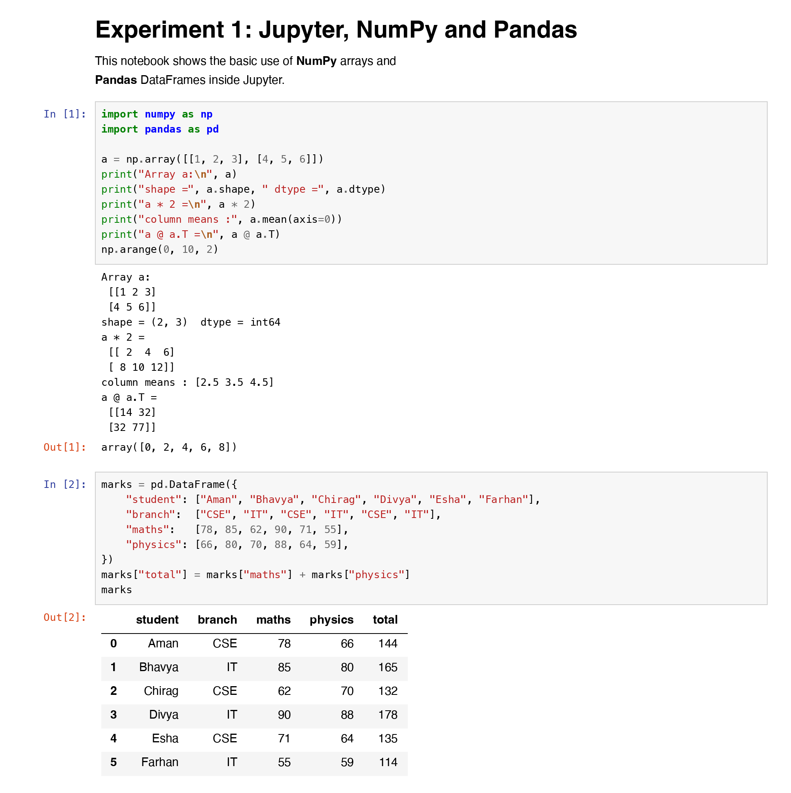
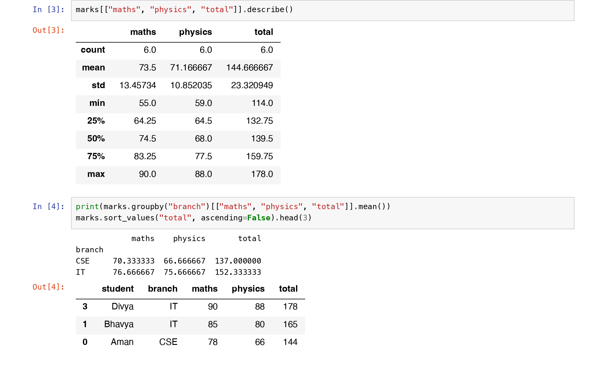
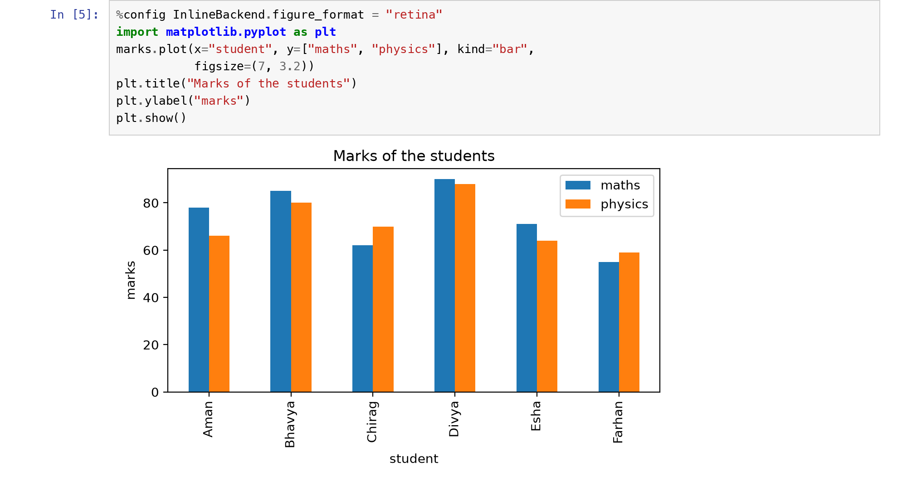

# Experiment 1: Jupyter IDE, Pandas and NumPy

> **File:** `exp1.py`  |  **Tools:** Python 3.13, Jupyter Notebook 7, NumPy, Pandas and Matplotlib, MacOS

## 🎯 Aim

To study the Jupyter IDE and its libraries Pandas and NumPy.

## 📘 Theory

Jupyter Notebook is a web based interactive environment in which code, its output, text and plots are kept together in one document called a notebook. A notebook is a list of cells. A code cell is run by a kernel (here the Python kernel) and its result is shown just below the cell, while a markdown cell holds headings and explanation. This makes Jupyter the most common tool for data analysis and machine learning work.

- **NumPy**: provides the fast n-dimensional array (ndarray), vectorised arithmetic, statistics and linear algebra on whole arrays without Python loops.
- **Pandas**: provides the DataFrame, a table with labelled rows and columns, with functions to select, sort, group, summarise and clean data.
- **Matplotlib**: draws plots; in Jupyter the plots appear below the cell that creates them.
- **Cells and kernel**: Shift + Enter runs a cell; the In [n] and Out [n] labels show the order of execution.
- **Notebook file**: saved with the extension .ipynb and can be shared or exported to HTML and PDF.

## 🪜 Algorithm / Steps

1. Install Jupyter Notebook and start it with the command jupyter notebook.
2. Create a new Python 3 notebook and add a markdown cell for the title.
3. Use NumPy to create an array and apply arithmetic, mean and matrix product on it.
4. Use Pandas to build a DataFrame of student marks, add a new column and summarise it with describe() and groupby().
5. Plot the marks as a bar chart inside the notebook.

## 💻 Code

```python
import numpy as np
import pandas as pd

a = np.array([[1, 2, 3], [4, 5, 6]])
print("Array a:\n", a)
print("shape =", a.shape, " dtype =", a.dtype)
print("a * 2 =\n", a * 2)
print("column means :", a.mean(axis=0))
print("a @ a.T =\n", a @ a.T)
np.arange(0, 10, 2)

marks = pd.DataFrame({
    "student": ["Aman", "Bhavya", "Chirag", "Divya", "Esha", "Farhan"],
    "branch":  ["CSE", "IT", "CSE", "IT", "CSE", "IT"],
    "maths":   [78, 85, 62, 90, 71, 55],
    "physics": [66, 80, 70, 88, 64, 59],
})
marks["total"] = marks["maths"] + marks["physics"]
marks

marks[["maths", "physics", "total"]].describe()

print(marks.groupby("branch")[["maths", "physics", "total"]].mean())
marks.sort_values("total", ascending=False).head(3)

%config InlineBackend.figure_format = "retina"
import matplotlib.pyplot as plt
marks.plot(x="student", y=["maths", "physics"], kind="bar",
           figsize=(7, 3.2))
plt.title("Marks of the students")
plt.ylabel("marks")
plt.show()
```

## 🖥️ Output

```text
(see figure below)
```

<p align="center"></p>

<p align="center"></p>

<p align="center"></p>

## ✅ Result

The notebook ran successfully. NumPy created a 2 × 3 array and performed vectorised arithmetic and a matrix product. Pandas built a DataFrame of 6 students; the average total marks are 137.0 for CSE and 152.33 for IT, and Divya has the highest total (178). The bar chart of maths and physics marks is shown below the last cell.

## 🎤 Viva Questions

**Q. What is Jupyter Notebook?**  
A. A web based tool in which code, results, plots and text are kept together in cells.

**Q. What is a kernel?**  
A. The process that runs the code of the notebook.

**Q. What is a NumPy array?**  
A. A fixed type n-dimensional block of numbers with fast element-wise operations.

**Q. What is a pandas DataFrame?**  
A. A table with labelled rows and columns.

**Q. What does groupby do?**  
A. It splits the rows into groups so that a summary can be calculated for each group.

---
[⬅ Back to index](README.md)
