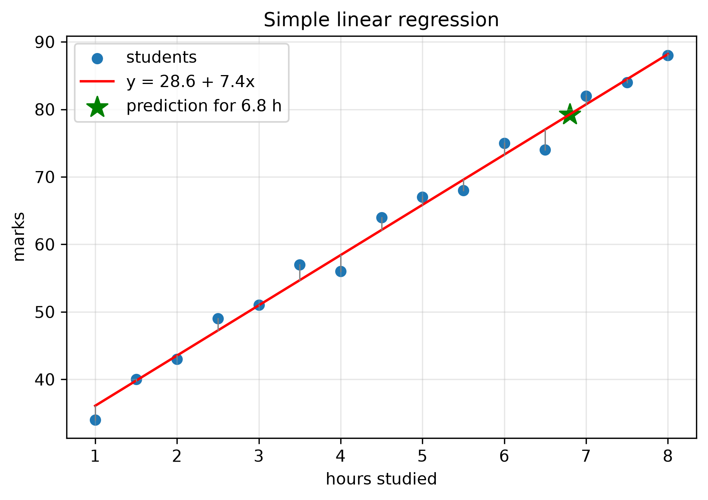

# Experiment 2: Simple Linear Regression

> **File:** `exp2.py`  |  **Tools:** Python 3.13, scikit-learn, NumPy and Matplotlib, MacOS

## 🎯 Aim

To demonstrate Simple Linear Regression.

## 📘 Theory

Simple linear regression models the relation between one input variable x and one output variable y as a straight line. The line is chosen so that the sum of the squared vertical distances (residuals) between the data points and the line is minimum; this is called the method of least squares. The slope, the intercept and the goodness of fit (R²) are calculated as follows:

- **Slope (β1)**: the change in y for a unit change in x.
- **Intercept (β0)**: the value of y when x is zero.
- **Residual**: the difference between the actual and the predicted value of y.
- **R² score**: the fraction of the variation of y explained by the line; 1.0 is a perfect fit.
- **RMSE**: the typical size of the prediction error in the units of y.

### 📐 Formulas

$$ y = {\beta }_{0} + {\beta }_{1}x $$

$$ {\beta }_{1} = \frac{\sum_{i = 1}^{n} \left({x}_{i} - \overline{x}\right)\left({y}_{i} - \overline{y}\right)}{\sum_{i = 1}^{n} {\left({x}_{i} - \overline{x}\right)}^{2}} $$

$$ {\beta }_{0} = \overline{y} - {\beta }_{1}\overline{x}, {R}^{2} = 1 - \frac{{SS}_{\text{res}}}{{SS}_{\text{tot}}} $$

## 🪜 Algorithm / Steps

1. Store the hours studied (x) and the marks obtained (y) of 15 students.
2. Calculate the means and then the slope and intercept with the least squares formulas.
3. Calculate the predictions, the R² score and the RMSE.
4. Verify the result with the LinearRegression class of scikit-learn.
5. Predict the marks for a new student and plot the data with the regression line.

## 💻 Code

```python
import numpy as np
import matplotlib.pyplot as plt
from sklearn.linear_model import LinearRegression

hours = np.array([1, 1.5, 2, 2.5, 3, 3.5, 4, 4.5,
                  5, 5.5, 6, 6.5, 7, 7.5, 8])
marks = np.array([34, 40, 43, 49, 51, 57, 56, 64,
                  67, 68, 75, 74, 82, 84, 88])

x_bar, y_bar = hours.mean(), marks.mean()
sxy = np.sum((hours - x_bar) * (marks - y_bar))
sxx = np.sum((hours - x_bar) ** 2)
b1 = sxy / sxx
b0 = y_bar - b1 * x_bar
pred = b0 + b1 * hours

ss_res = np.sum((marks - pred) ** 2)
ss_tot = np.sum((marks - y_bar) ** 2)
r2 = 1 - ss_res / ss_tot
rmse = np.sqrt(ss_res / len(marks))

print(f"Mean of x = {x_bar:.3f}, mean of y = {y_bar:.3f}")
print(f"Slope     b1 = {b1:.4f}")
print(f"Intercept b0 = {b0:.4f}")
print(f"Equation : marks = {b0:.2f} + {b1:.2f} * hours")
print(f"R-squared = {r2:.4f}    RMSE = {rmse:.3f}")

sk = LinearRegression().fit(hours.reshape(-1, 1), marks)
print(f"\nscikit-learn : slope = {sk.coef_[0]:.4f}, "
      f"intercept = {sk.intercept_:.4f}")

new = 6.8
print(f"\nPrediction for {new} hours of study : {b0 + b1 * new:.1f} marks")

plt.figure(figsize=(7, 4.5))
plt.scatter(hours, marks, color="#1f77b4", label="students")
plt.plot(hours, pred, color="red", label=f"y = {b0:.1f} + {b1:.1f}x")
for x, y, p in zip(hours, marks, pred):
    plt.plot([x, x], [y, p], color="gray", lw=0.8)
plt.scatter([new], [b0 + b1 * new], color="green", marker="*", s=180,
            label=f"prediction for {new} h")
plt.xlabel("hours studied"); plt.ylabel("marks")
plt.title("Simple linear regression"); plt.legend(); plt.grid(alpha=0.3)
plt.show()
```

## 🖥️ Output

```text
Mean of x = 4.500, mean of y = 62.133
Slope     b1 = 7.4429
Intercept b0 = 28.6405
Equation : marks = 28.64 + 7.44 * hours
R-squared = 0.9898    RMSE = 1.633

scikit-learn : slope = 7.4429, intercept = 28.6405

Prediction for 6.8 hours of study : 79.3 marks
```

<p align="center"></p>

## ✅ Result

The fitted line is marks = 28.64 + 7.44 × hours, so every extra hour of study adds about 7.4 marks. The R² score is 0.9898 and the RMSE is 1.633. scikit-learn gives exactly the same slope and intercept, and a student who studies 6.8 hours is predicted to score 79.3 marks.

## 🎤 Viva Questions

**Q. What does simple linear regression do?**  
A. It fits a straight line through the points of one input and one output.

**Q. What is the least squares method?**  
A. It chooses the line that makes the sum of the squared residuals smallest.

**Q. What do the slope and intercept mean?**  
A. The slope is the change of the output per unit of input, the intercept is the output at zero input.

**Q. What is a residual?**  
A. The actual value minus the predicted value.

**Q. What does R² show?**  
A. The fraction of the variation of the output that is explained by the line.

---
[⬅ Back to index](README.md)
