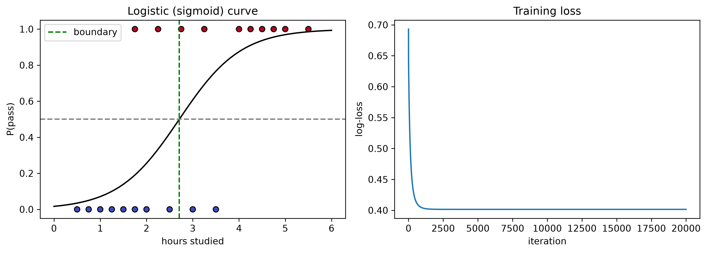

# Experiment 3: Logistic Regression

> **File:** `exp3.py`  |  **Tools:** Python 3.13, scikit-learn, NumPy and Matplotlib, MacOS

## 🎯 Aim

To demonstrate Logistic Regression.

## 📘 Theory

Logistic regression is a classification algorithm that predicts the probability that a record belongs to a class. A linear combination of the inputs is passed through the sigmoid function, which squeezes any value into the range 0 to 1. If the probability is 0.5 or more the record is put in class 1, otherwise in class 0. The weights are learned by minimising the log-loss with gradient descent:

- **Sigmoid function**: an S shaped curve that converts a score into a probability.
- **Log-loss**: a cost function that heavily punishes confident wrong predictions.
- **Decision boundary**: the input value where the probability is exactly 0.5.
- **Confusion matrix**: counts of true/false positives and negatives, used to judge the classifier.

### 📐 Formulas

$$ \sigma \left(z\right) = \frac{1}{1 + {e}^{-z}}, h\left(x\right) = \sigma \left(wx + b\right) $$

$$ J = -\frac{1}{m}\sum_{i = 1}^{m} [ {y}_{i} \log {h}_{i} + (1 - {y}_{i}) \log(1 - {h}_{i}) ] $$

$$ w := w - \alpha \frac{1}{m}\sum_{i = 1}^{m} \left({h}_{i} - {y}_{i}\right){x}_{i} $$

## 🪜 Algorithm / Steps

1. Store the hours studied and the result (pass = 1, fail = 0) of 20 students.
2. Start with w = 0 and b = 0 and update them with gradient descent for 20000 iterations.
3. Calculate the decision boundary, the accuracy and the confusion matrix.
4. Compare the learned weights with scikit-learn's LogisticRegression.
5. Plot the sigmoid curve over the data and the loss against the iterations.

## 💻 Code

```python
import numpy as np
import matplotlib.pyplot as plt
from sklearn.linear_model import LogisticRegression
from sklearn.metrics import confusion_matrix, accuracy_score

hours = np.array([0.5, 0.75, 1, 1.25, 1.5, 1.75, 1.75, 2, 2.25, 2.5,
                  2.75, 3, 3.25, 3.5, 4, 4.25, 4.5, 4.75, 5, 5.5])
passed = np.array([0, 0, 0, 0, 0, 0, 1, 0, 1, 0,
                   1, 0, 1, 0, 1, 1, 1, 1, 1, 1])

def sigmoid(z):
    return 1 / (1 + np.exp(-z))

w, b, lr = 0.0, 0.0, 0.1
losses = []
for _ in range(20000):
    p = sigmoid(w * hours + b)
    loss = -np.mean(passed * np.log(p) + (1 - passed) * np.log(1 - p))
    losses.append(loss)
    w -= lr * np.mean((p - passed) * hours)
    b -= lr * np.mean(p - passed)

pred = (sigmoid(w * hours + b) >= 0.5).astype(int)
print(f"Learned weight w = {w:.4f}, bias b = {b:.4f}")
print(f"Final log-loss   = {losses[-1]:.4f}")
print(f"Decision boundary (p = 0.5) at {-b / w:.2f} hours")
print(f"Training accuracy = {accuracy_score(passed, pred) * 100:.1f} %")
print("Confusion matrix [[TN FP] [FN TP]]:")
print(confusion_matrix(passed, pred))

sk = LogisticRegression(C=1e6).fit(hours.reshape(-1, 1), passed)
print(f"\nscikit-learn : w = {sk.coef_[0][0]:.4f}, "
      f"b = {sk.intercept_[0]:.4f}")
for h in (1.5, 3.0, 4.5):
    print(f"P(pass | {h} hours) = {sigmoid(w * h + b):.3f}")

xs = np.linspace(0, 6, 200)
fig, ax = plt.subplots(1, 2, figsize=(11, 4))
ax[0].scatter(hours, passed, c=passed, cmap="coolwarm", edgecolor="k")
ax[0].plot(xs, sigmoid(w * xs + b), color="black")
ax[0].axhline(0.5, color="gray", ls="--")
ax[0].axvline(-b / w, color="green", ls="--", label="boundary")
ax[0].set_xlabel("hours studied"); ax[0].set_ylabel("P(pass)")
ax[0].set_title("Logistic (sigmoid) curve"); ax[0].legend()
ax[1].plot(losses)
ax[1].set_xlabel("iteration"); ax[1].set_ylabel("log-loss")
ax[1].set_title("Training loss")
plt.tight_layout()
plt.show()
```

## 🖥️ Output

```text
Learned weight w = 1.5046, bias b = -4.0777
Final log-loss   = 0.4015
Decision boundary (p = 0.5) at 2.71 hours
Training accuracy = 80.0 %
Confusion matrix [[TN FP] [FN TP]]:
[[8 2]
 [2 8]]

scikit-learn : w = 1.5050, b = -4.0787
P(pass | 1.5 hours) = 0.139
P(pass | 3.0 hours) = 0.607
P(pass | 4.5 hours) = 0.937
```

<p align="center"></p>

## ✅ Result

Gradient descent gave w = 1.5046 and b = −4.0777, almost the same as scikit-learn (1.5050 and −4.0787). The decision boundary is at 2.71 hours of study and the training accuracy is 80 %. A student who studies 4.5 hours has a 93.7 % chance to pass, while one who studies 1.5 hours has only 13.9 %.

## 🎤 Viva Questions

**Q. Is logistic regression used for regression?**  
A. No, it is a classification method that predicts the probability of a class.

**Q. What is the sigmoid function?**  
A. 1 / (1 + e⁻ᶻ); it turns any score into a number between 0 and 1.

**Q. Which cost function is used?**  
A. The log-loss (cross-entropy), which punishes confident wrong answers strongly.

**Q. What is a confusion matrix?**  
A. A table of true and false positives and negatives.

**Q. What does the area under the ROC curve measure?**  
A. How well the model separates the two classes at all thresholds; 1 is perfect, 0.5 is random.

---
[⬅ Back to index](README.md)
