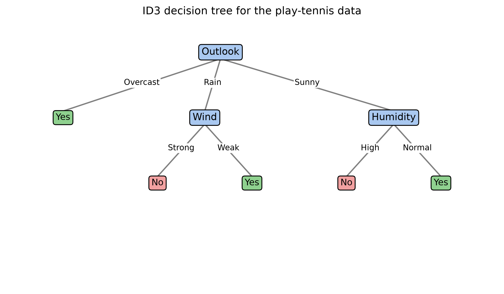

# Experiment 4: Decision Tree: ID3 algorithm

> **File:** `exp4.py`  |  **Tools:** Python 3.13, NumPy and Matplotlib, MacOS

## 🎯 Aim

To demonstrate the Decision Tree ID3 algorithm.

## 📘 Theory

A decision tree classifies a record by asking a series of questions about its attributes. The ID3 algorithm builds the tree from the top: at every node it chooses the attribute with the highest information gain, splits the data on its values and repeats the process on each part until the part is pure (all records have the same class). Information gain is based on entropy, which measures the impurity of a set of records:

- **Entropy**: 0 for a pure set and highest when the classes are equally mixed.
- **Information gain**: the drop in entropy obtained by splitting on an attribute.
- **Leaf node**: gives the final class (here Play = Yes or No).
- **Play-tennis data**: 14 days described by Outlook, Temperature, Humidity and Wind.

### 📐 Formulas

$$ H\left(S\right) = -\sum_{i = 1}^{c} {p}_{i} {\log}_{2} {p}_{i} $$

$$ \text{Gain}\left(S, A\right) = H\left(S\right) - \sum_{v} \frac{\left|{S}_{v}\right|}{\left|S\right|}H\left({S}_{v}\right) $$

## 🪜 Algorithm / Steps

1. Store the 14 records of the play-tennis data set.
2. Write functions to calculate entropy and information gain.
3. Write the recursive ID3 function that picks the best attribute, splits the data and builds the tree.
4. Print the tree, check it on the training data and classify a new day.
5. Draw the tree with Matplotlib.

## 💻 Code

```python
import math
from collections import Counter
import matplotlib.pyplot as plt

ATTRS = ["Outlook", "Temperature", "Humidity", "Wind"]
rows = [
    ("Sunny", "Hot", "High", "Weak", "No"),
    ("Sunny", "Hot", "High", "Strong", "No"),
    ("Overcast", "Hot", "High", "Weak", "Yes"),
    ("Rain", "Mild", "High", "Weak", "Yes"),
    ("Rain", "Cool", "Normal", "Weak", "Yes"),
    ("Rain", "Cool", "Normal", "Strong", "No"),
    ("Overcast", "Cool", "Normal", "Strong", "Yes"),
    ("Sunny", "Mild", "High", "Weak", "No"),
    ("Sunny", "Cool", "Normal", "Weak", "Yes"),
    ("Rain", "Mild", "Normal", "Weak", "Yes"),
    ("Sunny", "Mild", "Normal", "Strong", "Yes"),
    ("Overcast", "Mild", "High", "Strong", "Yes"),
    ("Overcast", "Hot", "Normal", "Weak", "Yes"),
    ("Rain", "Mild", "High", "Strong", "No"),
]
data = [dict(zip(ATTRS + ["Play"], r)) for r in rows]

def entropy(rs):
    counts = Counter(r["Play"] for r in rs)
    n = len(rs)
    return -sum(c / n * math.log2(c / n) for c in counts.values())

def gain(rs, attr):
    total = entropy(rs)
    for v in {r[attr] for r in rs}:
        part = [r for r in rs if r[attr] == v]
        total -= len(part) / len(rs) * entropy(part)
    return total

def id3(rs, attrs):
    labels = {r["Play"] for r in rs}
    if len(labels) == 1:
        return labels.pop()
    if not attrs:
        return Counter(r["Play"] for r in rs).most_common(1)[0][0]
    best = max(attrs, key=lambda a: gain(rs, a))
    rest = [a for a in attrs if a != best]
    return {best: {v: id3([r for r in rs if r[best] == v], rest)
                   for v in sorted({r[best] for r in rs})}}

def show(tree, indent=0):
    for attr, branches in tree.items():
        for v, sub in branches.items():
            if isinstance(sub, dict):
                print("  " * indent + f"{attr} = {v}")
                show(sub, indent + 1)
            else:
                print("  " * indent + f"{attr} = {v}  ->  Play = {sub}")

def predict(tree, sample):
    while isinstance(tree, dict):
        attr = next(iter(tree))
        tree = tree[attr][sample[attr]]
    return tree

print(f"Entropy of the whole data set = {entropy(data):.4f}")
print("Information gain of each attribute at the root:")
for a in sorted(ATTRS, key=lambda a: -gain(data, a)):
    print(f"   {a:<12} {gain(data, a):.4f}")

tree = id3(data, ATTRS)
print("\nDecision tree built by ID3:")
show(tree)

ok = sum(predict(tree, r) == r["Play"] for r in data)
print(f"\nTraining accuracy : {ok}/{len(data)}")
new = {"Outlook": "Sunny", "Temperature": "Cool", "Humidity": "High",
       "Wind": "Strong"}
print("New day", new, "->", predict(tree, new))

pos, leaf_x = {}, [0]
def layout(node, depth, name):
    if not isinstance(node, dict):
        pos[name] = (leaf_x[0], -depth); leaf_x[0] += 1
        return pos[name][0]
    attr = next(iter(node))
    xs = [layout(sub, depth + 1, name + "/" + v)
          for v, sub in node[attr].items()]
    pos[name] = (sum(xs) / len(xs), -depth)
    return pos[name][0]
layout(tree, 0, "root")

fig, ax = plt.subplots(figsize=(10, 5.5))
def draw(node, name):
    x, y = pos[name]
    if not isinstance(node, dict):
        c = "#8fd18f" if node == "Yes" else "#f2a1a1"
        ax.text(x, y, node, ha="center", va="center",
                bbox=dict(boxstyle="round", fc=c))
        return
    attr = next(iter(node))
    ax.text(x, y, attr, ha="center", va="center", fontsize=11,
            bbox=dict(boxstyle="round", fc="#a9c8f0"))
    for v, sub in node[attr].items():
        cx, cy = pos[name + "/" + v]
        ax.plot([x, cx], [y - 0.1, cy + 0.1], color="gray")
        ax.text((x + cx) / 2, (y + cy) / 2, v, fontsize=9, ha="center",
                bbox=dict(fc="white", ec="none", pad=1))
        draw(sub, name + "/" + v)
draw(tree, "root")
ax.set_xlim(-0.6, leaf_x[0] - 0.4); ax.set_ylim(-3.6, 0.5); ax.axis("off")
ax.set_title("ID3 decision tree for the play-tennis data")
plt.show()
```

## 🖥️ Output

```text
Entropy of the whole data set = 0.9403
Information gain of each attribute at the root:
   Outlook      0.2467
   Humidity     0.1518
   Wind         0.0481
   Temperature  0.0292

Decision tree built by ID3:
Outlook = Overcast  ->  Play = Yes
Outlook = Rain
  Wind = Strong  ->  Play = No
  Wind = Weak  ->  Play = Yes
Outlook = Sunny
  Humidity = High  ->  Play = No
  Humidity = Normal  ->  Play = Yes

Training accuracy : 14/14
New day {'Outlook': 'Sunny', 'Temperature': 'Cool', 'Humidity': 'High', 'Wind': 'Strong'} -> No
```

<p align="center"></p>

## ✅ Result

The entropy of the whole data is 0.9403 and Outlook has the highest information gain (0.2467), so it becomes the root. Overcast always gives Yes; Rain is decided by Wind and Sunny by Humidity. The tree classifies all 14 training records correctly and predicts No for a sunny, cool, humid and windy day.

## 🎤 Viva Questions

**Q. What does ID3 build?**  
A. A decision tree, choosing at each node the attribute with the highest information gain.

**Q. What is entropy?**  
A. A measure of impurity of a set; it is 0 for a pure set and 1 for an equal split of two classes.

**Q. What is information gain?**  
A. The reduction of entropy obtained by splitting on an attribute.

**Q. When does ID3 stop splitting?**  
A. When all records of a node have the same class or no attribute is left.

**Q. What is a weakness of ID3?**  
A. It can over-fit and it cannot handle numeric attributes without discretising them.

---
[⬅ Back to index](README.md)
