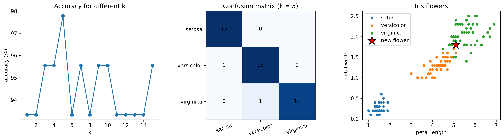

# Experiment 5: k-Nearest Neighbor: flowers classification

> **File:** `exp5.py`  |  **Tools:** Python 3.13, scikit-learn, NumPy and Matplotlib, MacOS

## 🎯 Aim

To demonstrate k-Nearest Neighbor classification of flowers.

## 📘 Theory

k-Nearest Neighbor (k-NN) is a simple, lazy learning algorithm. It does not build a model in advance; to classify a new record it finds the k training records that are closest to it and gives it the class which is most common among them. Closeness is measured with a distance such as the Euclidean distance. The iris data set has 150 flowers of three species described by sepal and petal length and width.

- **k**: the number of neighbours; a small k is sensitive to noise and a large k blurs the class boundaries.
- **Distance measure**: the Euclidean distance between the measurements of two flowers.
- **Majority vote**: the class that occurs most among the k neighbours is chosen.
- **Train-test split**: 70 % of the flowers are used for training and 30 % for testing.

### 📐 Formulas

$$ d\left(x, y\right) = \sqrt{\sum_{i = 1}^{n} {\left({x}_{i} - {y}_{i}\right)}^{2}} $$

$$ \hat{y} = \text{majority class of the k nearest neighbours} $$

## 🪜 Algorithm / Steps

1. Load the iris data and split it into 105 training and 45 test flowers.
2. Write a function that finds the k nearest training flowers and returns the majority class.
3. Calculate the test accuracy for k = 1 to 15 and select the best k.
4. Print the confusion matrix for k = 5 and compare the predictions with scikit-learn.
5. Classify a new flower and plot the results.

## 💻 Code

```python
import numpy as np
import matplotlib.pyplot as plt
from collections import Counter
from sklearn.datasets import load_iris
from sklearn.model_selection import train_test_split
from sklearn.metrics import confusion_matrix
from sklearn.neighbors import KNeighborsClassifier

iris = load_iris()
X, y, names = iris.data, iris.target, iris.target_names
X_tr, X_te, y_tr, y_te = train_test_split(X, y, test_size=0.3,
                                          stratify=y, random_state=42)

def knn_predict(x, k):
    d = np.sqrt(((X_tr - x) ** 2).sum(axis=1))
    nearest = y_tr[np.argsort(d)[:k]]
    return Counter(nearest).most_common(1)[0][0]

print(f"Training samples = {len(X_tr)}, test samples = {len(X_te)}")
accs = []
for k in range(1, 16):
    pred = np.array([knn_predict(x, k) for x in X_te])
    accs.append((pred == y_te).mean())
    if k in (1, 3, 5, 7, 9, 15):
        print(f"  k = {k:<2}  accuracy = {accs[-1] * 100:.2f} %")
best_k = int(np.argmax(accs)) + 1
print(f"Best k = {best_k}")

k = 5
pred = np.array([knn_predict(x, k) for x in X_te])
print(f"\nConfusion matrix for k = {k}")
cm = confusion_matrix(y_te, pred)
print(cm)

sk = KNeighborsClassifier(n_neighbors=k).fit(X_tr, y_tr)
print("Same predictions as scikit-learn :",
      (sk.predict(X_te) == pred).all())

flower = np.array([5.9, 3.0, 5.1, 1.8])
print("\nNew flower (sepal 5.9 x 3.0, petal 5.1 x 1.8) is classified as:",
      names[knn_predict(flower, k)])

fig, ax = plt.subplots(1, 3, figsize=(14, 4))
ax[0].plot(range(1, 16), np.array(accs) * 100, "o-")
ax[0].set_xlabel("k"); ax[0].set_ylabel("accuracy (%)")
ax[0].set_title("Accuracy for different k")
ax[1].imshow(cm, cmap="Blues")
for i in range(3):
    for j in range(3):
        ax[1].text(j, i, cm[i, j], ha="center", va="center")
ax[1].set_xticks(range(3)); ax[1].set_xticklabels(names, rotation=20)
ax[1].set_yticks(range(3)); ax[1].set_yticklabels(names)
ax[1].set_title(f"Confusion matrix (k = {k})")
for c in range(3):
    ax[2].scatter(X[y == c, 2], X[y == c, 3], label=names[c], s=18)
ax[2].scatter(flower[2], flower[3], marker="*", s=300, c="red",
              edgecolor="k", label="new flower")
ax[2].set_xlabel("petal length"); ax[2].set_ylabel("petal width")
ax[2].legend(); ax[2].set_title("Iris flowers")
plt.tight_layout()
plt.show()
```

## 🖥️ Output

```text
Training samples = 105, test samples = 45
  k = 1   accuracy = 93.33 %
  k = 3   accuracy = 95.56 %
  k = 5   accuracy = 97.78 %
  k = 7   accuracy = 95.56 %
  k = 9   accuracy = 95.56 %
  k = 15  accuracy = 95.56 %
Best k = 5

Confusion matrix for k = 5
[[15  0  0]
 [ 0 15  0]
 [ 0  1 14]]
Same predictions as scikit-learn : True

New flower (sepal 5.9 x 3.0, petal 5.1 x 1.8) is classified as: virginica
```

<p align="center"></p>

## ✅ Result

The best accuracy was 97.78 % at k = 5, and only one virginica flower was classified as versicolor. The predictions are identical to scikit-learn's KNeighborsClassifier, and the new flower (sepal 5.9 × 3.0, petal 5.1 × 1.8) is classified as Iris virginica.

## 🎤 Viva Questions

**Q. How does k-NN classify a flower?**  
A. It finds the k closest training flowers and takes the majority class.

**Q. Why is k-NN called a lazy learner?**  
A. There is no training step; it stores the data and works only when a query arrives.

**Q. How is k chosen?**  
A. By testing several values, usually odd ones, and picking the one with the best accuracy.

**Q. Which distance is used?**  
A. The Euclidean distance between the feature vectors.

**Q. Why do features need similar scales?**  
A. A feature with large values would dominate the distance.

---
[⬅ Back to index](README.md)
