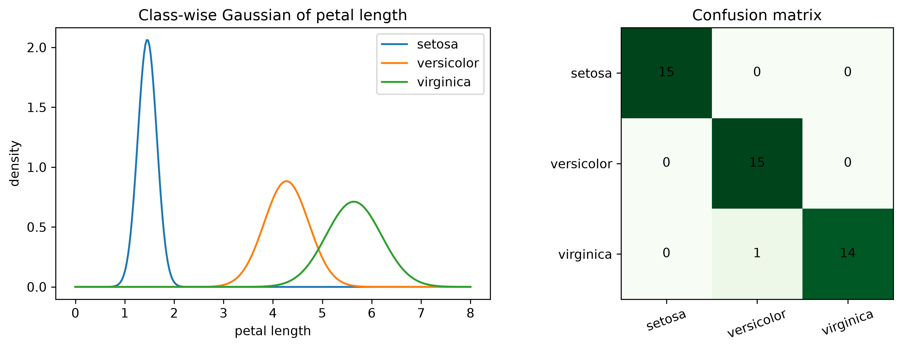

# Experiment 6: Naive Bayes classifier

> **File:** `exp6.py`  |  **Tools:** Python 3.13, scikit-learn, NumPy and Matplotlib, MacOS

## 🎯 Aim

To demonstrate the Naive Bayes classifier.

## 📘 Theory

The Naive Bayes classifier is based on Bayes' theorem. It finds the probability of every class for a given record and chooses the class with the highest probability. It is called naive because it assumes that all the attributes are independent of each other given the class. For continuous attributes the likelihood is taken from a Gaussian distribution whose mean and variance are calculated for every class from the training data.

- **Prior**: the probability of a class before looking at the attributes (its share in the training data).
- **Likelihood**: the probability of the attribute value given the class, from the class-wise Gaussian curve.
- **Posterior**: the updated probability of the class after seeing the attributes.
- **Log probabilities**: logarithms are added instead of multiplying small numbers, to avoid underflow.

### 📐 Formulas

$$ P\left(C | x\right) = \frac{P\left(x | C\right)P\left(C\right)}{P\left(x\right)} $$

$$ P\left({x}_{i} | C\right) = \frac{1}{\sqrt{2\pi {\sigma }^{2}}}{e}^{-\frac{{\left({x}_{i} - \mu \right)}^{2}}{2{\sigma }^{2}}} $$

$$ \hat{y} = {\operatorname{argmax}}_{C} P\left(C\right)\prod_{i} P\left({x}_{i} | C\right) $$

## 🪜 Algorithm / Steps

1. Split the iris data into 105 training and 45 test flowers.
2. Calculate the prior, the mean and the variance of every feature for each class.
3. Write a function that adds the log prior and the log Gaussian likelihoods and picks the class with the largest value.
4. Find the accuracy and the confusion matrix and compare with scikit-learn's GaussianNB.
5. Show the posterior probabilities for a new flower and plot the class-wise curves.

## 💻 Code

```python
import numpy as np
import matplotlib.pyplot as plt
from sklearn.datasets import load_iris
from sklearn.model_selection import train_test_split
from sklearn.metrics import confusion_matrix, accuracy_score
from sklearn.naive_bayes import GaussianNB

iris = load_iris()
X, y, names = iris.data, iris.target, iris.target_names
X_tr, X_te, y_tr, y_te = train_test_split(X, y, test_size=0.3,
                                          stratify=y, random_state=1)
classes = np.unique(y_tr)

prior = np.array([(y_tr == c).mean() for c in classes])
mean = np.array([X_tr[y_tr == c].mean(axis=0) for c in classes])
var = np.array([X_tr[y_tr == c].var(axis=0) for c in classes]) + 1e-9

def log_posterior(x):
    ll = -0.5 * np.log(2 * np.pi * var) - (x - mean) ** 2 / (2 * var)
    return np.log(prior) + ll.sum(axis=1)

def predict(x):
    return np.argmax(log_posterior(x))

for n, p in zip(names, prior):
    print(f"Prior P({n}) = {p:.3f}")
print("Mean of petal length per class :", np.round(mean[:, 2], 3))
pred = np.array([predict(x) for x in X_te])
print(f"\nAccuracy on {len(X_te)} test flowers = "
      f"{accuracy_score(y_te, pred) * 100:.2f} %")
cm = confusion_matrix(y_te, pred)
print(cm)

sk = GaussianNB().fit(X_tr, y_tr)
print("Agreement with scikit-learn GaussianNB :",
      f"{(sk.predict(X_te) == pred).mean() * 100:.1f} %")

flower = np.array([6.3, 2.8, 5.0, 1.7])
lp = log_posterior(flower)
post = np.exp(lp - lp.max()); post /= post.sum()
print("\nPosterior probabilities for a new flower", flower)
for n, p in zip(names, post):
    print(f"   P({n:<10} | x) = {p:.4f}")
print("Predicted class :", names[np.argmax(post)])

fig, ax = plt.subplots(1, 2, figsize=(11, 4))
xs = np.linspace(0, 8, 300)
for c in classes:
    g = np.exp(-(xs - mean[c, 2]) ** 2 / (2 * var[c, 2]))
    ax[0].plot(xs, g / np.sqrt(2 * np.pi * var[c, 2]), label=names[c])
ax[0].set_xlabel("petal length"); ax[0].set_ylabel("density")
ax[0].set_title("Class-wise Gaussian of petal length"); ax[0].legend()
ax[1].imshow(cm, cmap="Greens")
for i in range(3):
    for j in range(3):
        ax[1].text(j, i, cm[i, j], ha="center", va="center")
ax[1].set_xticks(range(3)); ax[1].set_xticklabels(names, rotation=20)
ax[1].set_yticks(range(3)); ax[1].set_yticklabels(names)
ax[1].set_title("Confusion matrix")
plt.tight_layout()
plt.show()
```

## 🖥️ Output

```text
Prior P(setosa) = 0.333
Prior P(versicolor) = 0.333
Prior P(virginica) = 0.333
Mean of petal length per class : [1.457 4.274 5.637]

Accuracy on 45 test flowers = 97.78 %
[[15  0  0]
 [ 0 15  0]
 [ 0  1 14]]
Agreement with scikit-learn GaussianNB : 100.0 %

Posterior probabilities for a new flower [6.3 2.8 5.  1.7]
   P(setosa     | x) = 0.0000
   P(versicolor | x) = 0.3075
   P(virginica  | x) = 0.6925
Predicted class : virginica
```

<p align="center"></p>

## ✅ Result

The classifier reached an accuracy of 97.78 % on the 45 test flowers, and its predictions agree 100 % with scikit-learn's GaussianNB. For the new flower (6.3, 2.8, 5.0, 1.7) the posterior probability is 0.6925 for virginica and 0.3075 for versicolor, so it is classified as virginica.

## 🎤 Viva Questions

**Q. What is Bayes' theorem?**  
A. P(class | data) = P(data | class) × P(class) / P(data).

**Q. Why is it called naive?**  
A. It assumes that the features are independent of each other given the class.

**Q. What are the prior and the likelihood?**  
A. The prior is the share of each class; the likelihood is the probability of the feature values inside a class.

**Q. Why are logarithms of probabilities added?**  
A. To avoid multiplying many very small numbers.

**Q. What distribution is used for continuous features?**  
A. A Gaussian with its own mean and variance for each class and feature.

---
[⬅ Back to index](README.md)
