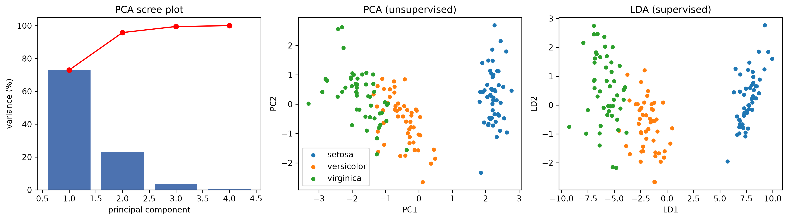

# Experiment 7: PCA and LDA on the Iris dataset

> **File:** `exp7.py`  |  **Tools:** Python 3.13, scikit-learn, NumPy and Matplotlib, MacOS

## 🎯 Aim

To demonstrate PCA and LDA on the Iris dataset.

## 📘 Theory

Principal Component Analysis (PCA) and Linear Discriminant Analysis (LDA) reduce the number of features of a data set. PCA is unsupervised: it finds the directions (principal components) along which the data has the largest variance and ignores the class labels. LDA is supervised: it finds the directions which separate the classes best, by making the distance between the class means large and the spread inside each class small.

- **Covariance matrix**: shows how the features vary together; its eigenvectors are the principal components.
- **Explained variance**: the share of the total variance carried by every component.
- **Standardisation**: every feature is scaled to mean 0 and variance 1 before PCA.
- **Between and within class scatter**: S_B and S_W, the two matrices used by LDA.

### 📐 Formulas

$$ \Sigma = \frac{1}{n - 1}{X}^{T}X, \Sigma v = \lambda v $$

$$ J\left(w\right) = \frac{{w}^{T}{S}_{B}w}{{w}^{T}{S}_{W}w} $$

## 🪜 Algorithm / Steps

1. Load the iris data and standardise the four features.
2. Calculate the covariance matrix and its eigenvalues and eigenvectors, and sort them.
3. Project the data on the first two components and compare with scikit-learn's PCA.
4. Apply LinearDiscriminantAnalysis with two components.
5. Plot the scree plot, the PCA projection and the LDA projection.

## 💻 Code

```python
import numpy as np
import matplotlib.pyplot as plt
from sklearn.datasets import load_iris
from sklearn.decomposition import PCA
from sklearn.discriminant_analysis import LinearDiscriminantAnalysis

iris = load_iris()
X, y, names = iris.data, iris.target, iris.target_names

Xs = (X - X.mean(axis=0)) / X.std(axis=0)
cov = np.cov(Xs, rowvar=False)
vals, vecs = np.linalg.eigh(cov)
order = np.argsort(vals)[::-1]
vals, vecs = vals[order], vecs[:, order]
ratio = vals / vals.sum()
Z_pca = Xs @ vecs[:, :2]

print("Eigenvalues           :", np.round(vals, 4))
print("Explained variance (%):", np.round(ratio * 100, 2))
print("Cumulative (%)        :", np.round(np.cumsum(ratio) * 100, 2))

sk = PCA(n_components=2).fit(Xs)
print("\nscikit-learn PCA ratio:",
      np.round(sk.explained_variance_ratio_, 4))
same = np.allclose(np.abs(sk.transform(Xs)), np.abs(Z_pca))
print("Same components as scikit-learn (up to sign) :", same)

lda = LinearDiscriminantAnalysis(n_components=2).fit(X, y)
Z_lda = lda.transform(X)
print("\nLDA explained variance ratio :",
      np.round(lda.explained_variance_ratio_, 4))
print(f"LDA classification accuracy  : {lda.score(X, y) * 100:.2f} %")

fig, ax = plt.subplots(1, 3, figsize=(14, 4))
ax[0].bar(range(1, 5), ratio * 100, color="#4c72b0")
ax[0].plot(range(1, 5), np.cumsum(ratio) * 100, "ro-")
ax[0].set_xlabel("principal component"); ax[0].set_ylabel("variance (%)")
ax[0].set_title("PCA scree plot")
for c in range(3):
    ax[1].scatter(Z_pca[y == c, 0], Z_pca[y == c, 1], label=names[c], s=18)
    ax[2].scatter(Z_lda[y == c, 0], Z_lda[y == c, 1], label=names[c], s=18)
ax[1].set_xlabel("PC1"); ax[1].set_ylabel("PC2")
ax[1].set_title("PCA (unsupervised)")
ax[2].set_xlabel("LD1"); ax[2].set_ylabel("LD2")
ax[2].set_title("LDA (supervised)")
ax[1].legend()
plt.tight_layout()
plt.show()
```

## 🖥️ Output

```text
Eigenvalues           : [2.9381 0.9202 0.1477 0.0209]
Explained variance (%): [72.96 22.85  3.67  0.52]
Cumulative (%)        : [ 72.96  95.81  99.48 100.  ]

scikit-learn PCA ratio: [0.7296 0.2285]
Same components as scikit-learn (up to sign) : True

LDA explained variance ratio : [0.9912 0.0088]
LDA classification accuracy  : 98.00 %
```

<p align="center"></p>

## ✅ Result

The first two principal components carry 72.96 % and 22.85 % of the variance, together 95.81 %, and they match scikit-learn's PCA. The LDA projection has 99.12 % of its separation in the first discriminant and classifies 98.00 % of the flowers correctly. In both plots Iris setosa is clearly separated, and LDA separates versicolor and virginica better than PCA.

## 🎤 Viva Questions

**Q. What does PCA do?**  
A. It finds the directions of largest variance and projects the data on them to reduce the dimensions.

**Q. Is LDA supervised or unsupervised?**  
A. Supervised; it uses the class labels to find directions that separate the classes.

**Q. What are eigenvalues and eigenvectors in PCA?**  
A. The eigenvectors of the covariance matrix are the components and the eigenvalues are their variances.

**Q. What is the explained variance ratio?**  
A. The share of the total variance carried by a component.

**Q. Why can LDA separate classes better than PCA?**  
A. PCA ignores labels, LDA maximises the distance between classes relative to their spread.

---
[⬅ Back to index](README.md)
