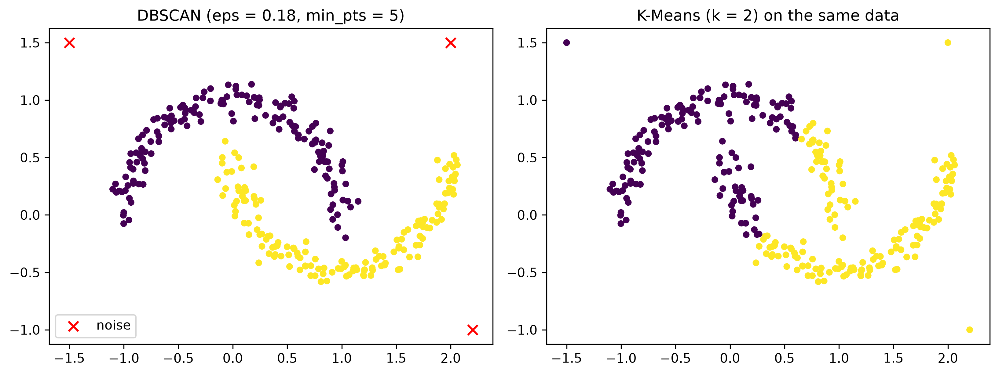

# Experiment 8: DBSCAN clustering algorithm

> **File:** `exp8.py`  |  **Tools:** Python 3.13, scikit-learn, NumPy and Matplotlib, MacOS

## 🎯 Aim

To demonstrate the DBSCAN clustering algorithm.

## 📘 Theory

DBSCAN (Density-Based Spatial Clustering of Applications with Noise) forms clusters from dense regions of points. It needs no number of clusters in advance, can find clusters of any shape and marks the points that lie in sparse regions as noise. It uses two parameters, the radius ε and the minimum number of points MinPts:

- **Core point**: has at least MinPts points (including itself) within the distance ε.
- **Border point**: is not a core point but lies within ε of a core point.
- **Noise point**: is neither core nor border; it gets the label −1.
- **Cluster expansion**: a cluster grows by repeatedly adding the neighbours of its core points.

### 📐 Formulas

$$ {N}_{\epsilon }\left(p\right) = \left\{q : d(p, q) \le \epsilon \right\} $$

$$ p is a core point if \left|{N}_{\epsilon }\left(p\right)\right| \ge MinPts $$

## 🪜 Algorithm / Steps

1. Generate 300 points in the shape of two half moons and add 3 outliers.
2. Write the DBSCAN function: find the neighbours of every point, start a cluster from every unvisited core point and expand it.
3. Run it with ε = 0.18 and MinPts = 5 and count the clusters and the noise points.
4. Compare with scikit-learn's DBSCAN and with K-Means, and study the effect of ε.
5. Plot the clusters and the noise points.

## 💻 Code

```python
import numpy as np
import matplotlib.pyplot as plt
from sklearn.datasets import make_moons
from sklearn.cluster import DBSCAN, KMeans
from sklearn.metrics import adjusted_rand_score

X, y_true = make_moons(n_samples=300, noise=0.07, random_state=3)
X = np.vstack([X, [[2.0, 1.5], [-1.5, 1.5], [2.2, -1.0]]])

def dbscan(X, eps, min_pts):
    n = len(X)
    D = np.sqrt(((X[:, None, :] - X[None, :, :]) ** 2).sum(axis=2))
    neigh = [np.where(D[i] <= eps)[0] for i in range(n)]
    labels = np.full(n, -1)
    cluster = 0
    for i in range(n):
        if labels[i] != -1 or len(neigh[i]) < min_pts:
            continue
        labels[i] = cluster
        queue = list(neigh[i])
        while queue:
            j = queue.pop()
            if labels[j] == -1:
                labels[j] = cluster
                if len(neigh[j]) >= min_pts:
                    queue.extend(neigh[j])
        cluster += 1
    return labels

labels = dbscan(X, eps=0.18, min_pts=5)
print(f"Points = {len(X)}")
print("Clusters found :", len(set(labels) - {-1}))
print("Noise points   :", int((labels == -1).sum()))
ids = sorted(set(labels) - {-1})
print("Cluster sizes  :", [int((labels == c).sum()) for c in ids])

sk = DBSCAN(eps=0.18, min_samples=5).fit_predict(X)
print("Agreement with scikit-learn (ARI) :",
      round(adjusted_rand_score(sk, labels), 3))

km = KMeans(n_clusters=2, n_init=10, random_state=0).fit_predict(X)
print(f"K-Means agreement with the two moons : "
      f"{adjusted_rand_score(y_true, km[:300]):.3f}")
print(f"DBSCAN  agreement with the two moons : "
      f"{adjusted_rand_score(y_true, labels[:300]):.3f}")

print("\nEffect of eps (min_pts = 5)")
for eps in (0.05, 0.1, 0.18, 0.4, 0.8):
    lab = dbscan(X, eps, 5)
    print(f"  eps = {eps:<4} clusters = {len(set(lab) - {-1})}, "
          f"noise = {(lab == -1).sum()}")

fig, ax = plt.subplots(1, 2, figsize=(11, 4.2))
noise = labels == -1
ax[0].scatter(X[~noise, 0], X[~noise, 1], c=labels[~noise],
              cmap="viridis", s=18)
ax[0].scatter(X[noise, 0], X[noise, 1], c="red", marker="x", s=60,
              label="noise")
ax[0].set_title("DBSCAN (eps = 0.18, min_pts = 5)"); ax[0].legend()
ax[1].scatter(X[:, 0], X[:, 1], c=km, cmap="viridis", s=18)
ax[1].set_title("K-Means (k = 2) on the same data")
plt.tight_layout()
plt.show()
```

## 🖥️ Output

```text
Points = 303
Clusters found : 2
Noise points   : 3
Cluster sizes  : [150, 150]
Agreement with scikit-learn (ARI) : 1.0
K-Means agreement with the two moons : 0.241
DBSCAN  agreement with the two moons : 1.000

Effect of eps (min_pts = 5)
  eps = 0.05 clusters = 5, noise = 276
  eps = 0.1  clusters = 10, noise = 48
  eps = 0.18 clusters = 2, noise = 3
  eps = 0.4  clusters = 1, noise = 3
  eps = 0.8  clusters = 1, noise = 3
```

<p align="center"></p>

## ✅ Result

DBSCAN found 2 clusters of 150 points each and marked the 3 outliers as noise; its result is identical to scikit-learn (ARI = 1.0). It recovered the two moons perfectly (ARI = 1.000), whereas K-Means could only reach 0.241. The study of ε shows that a very small ε gives many clusters and mostly noise, and a large ε merges everything into one cluster.

## 🎤 Viva Questions

**Q. What does DBSCAN stand for?**  
A. Density-Based Spatial Clustering of Applications with Noise.

**Q. What are eps and MinPts?**  
A. eps is the radius of a neighbourhood and MinPts is the number of points needed to make a point a core point.

**Q. What are core, border and noise points?**  
A. Core points have enough neighbours, border points lie near a core point, and noise belongs to no cluster.

**Q. Why can DBSCAN find non-circular clusters?**  
A. Clusters grow along dense regions, so any shape can be found.

**Q. Do we need to give the number of clusters?**  
A. No, DBSCAN finds it by itself.

---
[⬅ Back to index](README.md)
