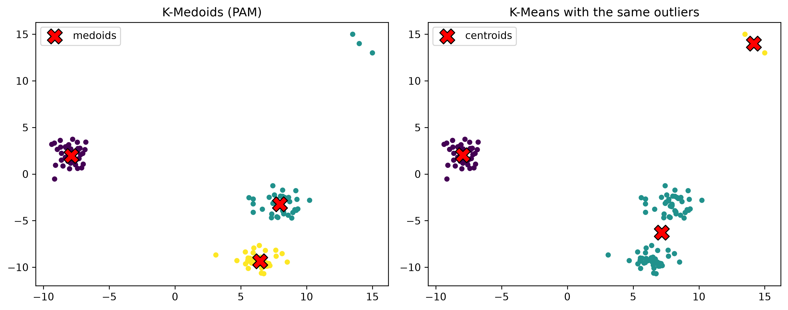

# Experiment 9: K-Medoid clustering algorithm

> **File:** `exp9.py`  |  **Tools:** Python 3.13, scikit-learn, NumPy and Matplotlib, MacOS

## 🎯 Aim

To demonstrate the K-Medoid clustering algorithm.

## 📘 Theory

K-Medoids is a clustering algorithm similar to K-Means, but every cluster is represented by a medoid, which is an actual data point of the cluster, instead of the mean. The medoid is the point whose total distance to all the other points of the cluster is smallest. Since medoids are real points and the total distance is minimised instead of the squared distance, the algorithm is much less affected by outliers. The Partitioning Around Medoids (PAM) algorithm minimises the cost:

- **Medoid**: the most central actual point of a cluster.
- **Swap step**: a medoid is exchanged with a non-medoid point if this lowers the total cost.
- **Robustness**: an outlier cannot pull a medoid towards itself as it pulls a mean.
- **Cost**: the total distance of all the points to the medoid of their cluster.

### 📐 Formulas

$$ \text{Cost} = \sum_{i = 1}^{n} \min d\left({x}_{i}, {m}_{j}\right) $$

## 🪜 Algorithm / Steps

1. Generate 120 points in three groups and add 3 far away outliers.
2. Choose k = 3 random points as the starting medoids.
3. Try every swap of a medoid with a non-medoid point and keep the swap that gives the lowest cost; stop when no swap helps.
4. Assign every point to its nearest medoid and print the medoids and the cluster sizes.
5. Compare with K-Means on the same data and plot both results.

## 💻 Code

```python
import numpy as np
import matplotlib.pyplot as plt
from sklearn.datasets import make_blobs
from sklearn.cluster import KMeans

rng = np.random.default_rng(2)
X, _ = make_blobs(n_samples=120, centers=3, cluster_std=0.9, random_state=6)
X = np.vstack([X, [[14, 14], [15, 13], [13.5, 15]]])
K = 3

def pam(X, k, seed=0):
    D = np.sqrt(((X[:, None, :] - X[None, :, :]) ** 2).sum(axis=2))
    r = np.random.default_rng(seed)
    med = list(r.choice(len(X), k, replace=False))
    cost = D[:, med].min(axis=1).sum()
    swaps = 0
    while True:
        best = (cost, None, None)
        for mi in range(k):
            for cand in range(len(X)):
                if cand in med:
                    continue
                trial = med.copy(); trial[mi] = cand
                c = D[:, trial].min(axis=1).sum()
                if c < best[0]:
                    best = (c, mi, cand)
        if best[1] is None:
            break
        med[best[1]] = best[2]; cost = best[0]; swaps += 1
    return D[:, med].argmin(axis=1), np.array(med), cost, swaps

labels, med, cost, swaps = pam(X, K)
print(f"Points = {len(X)} (3 of them are outliers), k = {K}")
print(f"PAM finished after {swaps} swaps, total cost = {cost:.2f}")
print("Medoids (actual data points):")
print(np.round(X[med], 2))
print("Cluster sizes :", np.bincount(labels))

km = KMeans(n_clusters=K, n_init=10, random_state=0).fit(X)
print("\nK-Means centroids (means, not data points):")
print(np.round(km.cluster_centers_, 2))
print("Cluster sizes :", np.bincount(km.labels_))
out_cluster = labels[-1]
print("\nAll three outliers are in the same PAM cluster :",
      len(set(labels[-3:])) == 1)

fig, ax = plt.subplots(1, 2, figsize=(11, 4.4))
ax[0].scatter(X[:, 0], X[:, 1], c=labels, cmap="viridis", s=18)
ax[0].scatter(X[med, 0], X[med, 1], marker="X", s=220, c="red",
              edgecolor="k", label="medoids")
ax[0].set_title("K-Medoids (PAM)"); ax[0].legend()
ax[1].scatter(X[:, 0], X[:, 1], c=km.labels_, cmap="viridis", s=18)
ax[1].scatter(*km.cluster_centers_.T, marker="X", s=220, c="red",
              edgecolor="k", label="centroids")
ax[1].set_title("K-Means with the same outliers"); ax[1].legend()
plt.tight_layout()
plt.show()
```

## 🖥️ Output

```text
Points = 123 (3 of them are outliers), k = 3
PAM finished after 3 swaps, total cost = 184.00
Medoids (actual data points):
[[-7.88  1.95]
 [ 7.96 -3.24]
 [ 6.47 -9.36]]
Cluster sizes : [40 43 40]

K-Means centroids (means, not data points):
[[-7.95  2.04]
 [ 7.17 -6.28]
 [14.17 14.  ]]
Cluster sizes : [40 80  3]

All three outliers are in the same PAM cluster : True
```

<p align="center"></p>

## ✅ Result

PAM stopped after 3 swaps with a total cost of 184.00 and found the three real groups (sizes 40, 43 and 40), with all the medoids being actual data points. K-Means on the same data wasted one centroid on the 3 outliers (cluster of size 3) and merged two real groups into one cluster of 80 points, which shows that K-Medoids handles outliers better.

## 🎤 Viva Questions

**Q. What is a medoid?**  
A. An actual data point that is the most central point of its cluster.

**Q. How does PAM work?**  
A. It chooses medoids, assigns points to the nearest one and swaps medoids while the total distance falls.

**Q. Why is K-Medoids less sensitive to outliers than K-Means?**  
A. The centre is a real point and not an average that an outlier can pull away.

**Q. What does the silhouette score measure?**  
A. How well each point fits its own cluster compared with the nearest other cluster, from −1 to 1.

**Q. What distance did we use?**  
A. The Manhattan distance between the points.

---
[⬅ Back to index](README.md)
