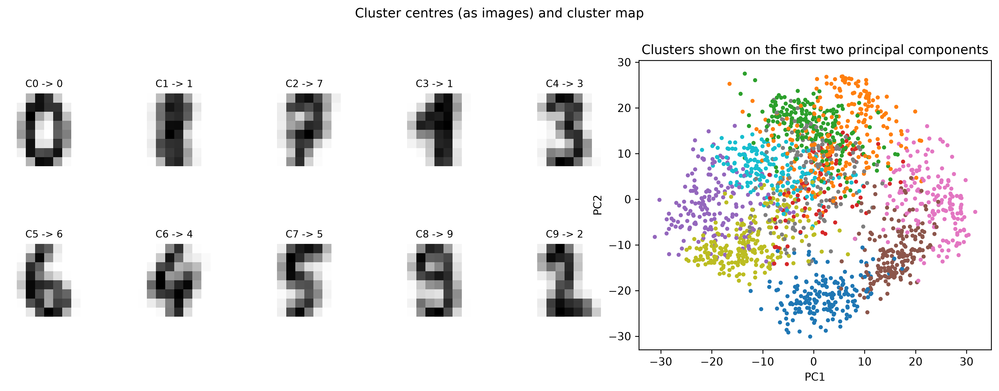

# Experiment 10: K-Means on a handwritten dataset

> **File:** `exp10.py`  |  **Tools:** Python 3.13, scikit-learn, NumPy and Matplotlib, MacOS

## 🎯 Aim

To demonstrate the K-Means clustering algorithm on a handwritten digits dataset.

## 📘 Theory

K-Means divides the data into k clusters by repeating two steps: assign every record to the nearest centroid, and move every centroid to the mean of the records assigned to it. It stops when the centroids no longer move. The algorithm reduces the sum of squared errors (SSE). Here it is applied to the scikit-learn digits data set, which has 1797 handwritten digits (0 to 9) stored as 8 × 8 pixel images, i.e. 64 features. The labels are not used for clustering and are used only to judge the result.

- **Centroid image**: the centroid of a cluster is a 64 value vector which can be shown as an average digit image.
- **Inertia**: the SSE of the final clustering.
- **Adjusted Rand Index and NMI**: compare the clusters with the real digits (1.0 means a perfect match).
- **Cluster naming**: every cluster is named by the digit which occurs most often in it to find the accuracy.

### 📐 Formulas

$$ \text{SSE} = \sum_{k = 1}^{K} \sum_{x \in {C}_{k}} {\left\|x - {\mu }_{k}\right\|}^{2} $$

$$ {\mu }_{k} = \frac{1}{\left|{C}_{k}\right|}\sum_{x \in {C}_{k}} x $$

## 🪜 Algorithm / Steps

1. Load the digits data set (1797 images of 64 pixels).
2. Run K-Means with k = 10 and n_init = 10.
3. Find the inertia, silhouette score, ARI, NMI, homogeneity and completeness.
4. Name every cluster with its majority digit, find the accuracy and print the cluster against digit table.
5. Display the ten centroid images and the clusters on the first two principal components.

## 💻 Code

```python
import numpy as np
import matplotlib.pyplot as plt
from sklearn.datasets import load_digits
from sklearn.cluster import KMeans
from sklearn.decomposition import PCA
from sklearn.metrics import (adjusted_rand_score,
                             normalized_mutual_info_score,
                             homogeneity_score, completeness_score,
                             silhouette_score)

digits = load_digits()
X, y = digits.data, digits.target
print("Images :", X.shape[0], "  pixels per image :", X.shape[1])

km = KMeans(n_clusters=10, n_init=10, random_state=0).fit(X)
labels = km.labels_
print(f"Inertia (SSE)        : {km.inertia_:.1f}")
print(f"Iterations           : {km.n_iter_}")
print(f"Silhouette score     : {silhouette_score(X, labels):.3f}")
print(f"Adjusted Rand Index  : {adjusted_rand_score(y, labels):.3f}")
nmi = normalized_mutual_info_score(y, labels)
print(f"Normalised mutual info : {nmi:.3f}")
print(f"Homogeneity          : {homogeneity_score(y, labels):.3f}")
print(f"Completeness         : {completeness_score(y, labels):.3f}")

table = np.zeros((10, 10), dtype=int)
for c, d in zip(labels, y):
    table[c, d] += 1
mapping = table.argmax(axis=1)
acc = np.mean(mapping[labels] == y)
print(f"\nAccuracy after naming clusters by majority digit : "
      f"{acc * 100:.2f} %")
print("\nrows = cluster, columns = real digit")
print("      " + " ".join(f"{d:>3}" for d in range(10)))
for c in range(10):
    print(f"C{c:<3}  " + " ".join(f"{v:>3}" for v in table[c]))

fig = plt.figure(figsize=(13, 5))
for c in range(10):
    ax = fig.add_subplot(2, 8, c + 1 if c < 5 else c + 4)
    ax.imshow(km.cluster_centers_[c].reshape(8, 8), cmap="gray_r")
    ax.set_title(f"C{c} -> {mapping[c]}", fontsize=9); ax.axis("off")
ax = fig.add_subplot(1, 2, 2)
Z = PCA(n_components=2).fit_transform(X)
sc = ax.scatter(Z[:, 0], Z[:, 1], c=labels, cmap="tab10", s=8)
ax.set_title("Clusters shown on the first two principal components")
ax.set_xlabel("PC1"); ax.set_ylabel("PC2")
fig.suptitle("Cluster centres (as images) and cluster map", y=1.0)
plt.tight_layout()
plt.show()
```

## 🖥️ Output

```text
Images : 1797   pixels per image : 64
Inertia (SSE)        : 1165188.9
Iterations           : 17
Silhouette score     : 0.183
Adjusted Rand Index  : 0.666
Normalised mutual info : 0.742
Homogeneity          : 0.738
Completeness         : 0.747

Accuracy after naming clusters by majority digit : 79.19 %

rows = cluster, columns = real digit
        0   1   2   3   4   5   6   7   8   9
C0    176   0   1   0   0   0   1   0   0   0
C1      0 100   8   7   2   0   3   2 100   1
C2      0   0   3   7  11   0   0 174   5   8
C3      0  54   2   0   3   0   0   2   6  20
C4      0   1  13 154   0   2   0   0   2   6
C5      0   2   0   0   0   1 177   0   2   0
C6      2   0   0   0 165   2   0   0   0   0
C7      0   1   0   2   0 136   0   1   4   6
C8      0   0   2  13   0  41   0   0  52 139
C9      0  24 148   0   0   0   0   0   3   0
```

<p align="center"></p>

## ✅ Result

K-Means converged in 17 iterations with an ARI of 0.666 and an NMI of 0.742. After naming every cluster by its majority digit, 79.19 % of the images are in the right cluster. The centroid images clearly look like the digits 0, 1, 3, 4, 5, 6, 7, 9 and 2, but digits 1, 8 and 9 are often mixed because they have a similar shape.

## 🎤 Viva Questions

**Q. What does K-Means minimise?**  
A. The sum of squared distances of the points to their cluster centroid (inertia).

**Q. What are the two repeating steps?**  
A. Assign each point to the nearest centroid, then move each centroid to the mean of its points.

**Q. How can k be chosen?**  
A. With the elbow method or the silhouette score.

**Q. Why is K-Means unsupervised?**  
A. It does not use the labels; the digit labels are only used afterwards for checking.

**Q. What does the adjusted Rand index show?**  
A. The agreement between the clusters and the true labels; 1 is perfect.

---
[⬅ Back to index](README.md)
